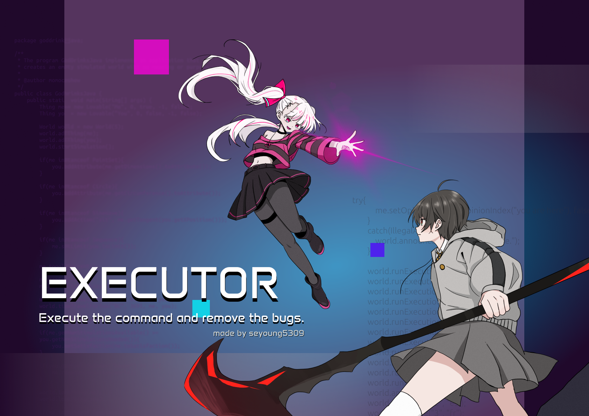

<h1 align="center">Executor</h1>

<i>Execute the command. Eliminate the bug.</i>

**Executor** is a developer-themed, grid-based, turn-based puzzle game where you must eliminate bugs, collect keys, and reach the exit within a limited number of moves.
Programming concepts like bugs, errors, and debugging are woven into the game's mechanics, so simple controls still lead to strategic thinking about the optimal path.
Build your own maps, share them with friends, and compete on records — we aim to make developer culture fun and approachable for everyone.

  

